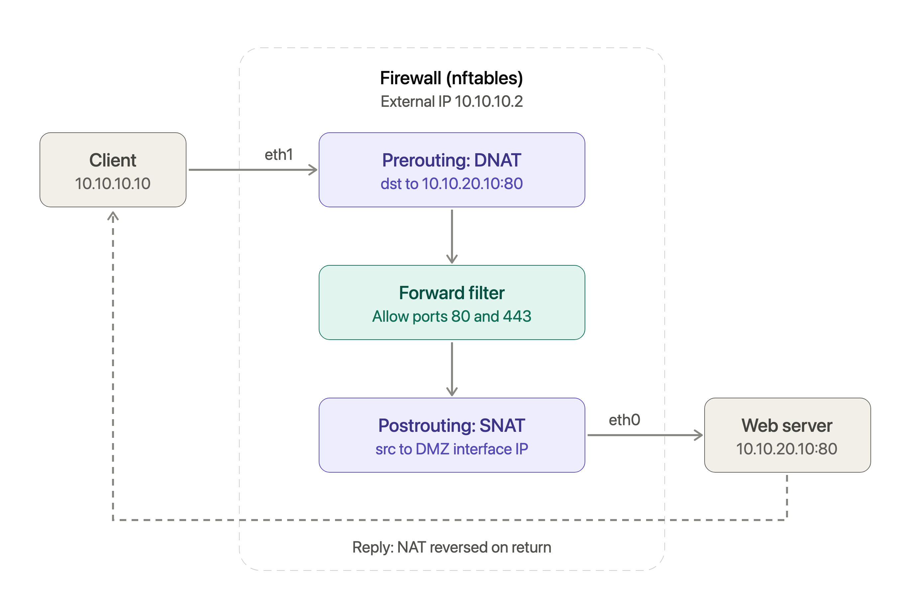

# Architecture

 It uses a network segmented gateway and I used nftables to isolate the different services from external / outside access.

## Services

The segmentation breaks down the different services into separate subnets.

- 10.10.10.10 is the outside / external requests and 10.10.10.2 is where our firewall can be accessed from.
- 10.10.20.10 is the DMZ or demilitarized zone is a special network where it is partially restricted in that external services can access it via NAT allowing HTTP/HTTPS requests to be sent on port 8080. SNAT was added as a workaround to by-pass Docker's internal networking. This network hosts our web server.
- 10.10.30.10 is the internal service network where all internal API's can be called or calls.
- 10.10.40.20 is our heavily restricted network where the database can be accessed.

## Packet Lifecycle

1. External client sends a request for a TCP connection, their IP is 10.10.10.10
2. This hits our Firewall's external interface *eth1*

3. Connection is made and the destination is the Web server, the firewall's external IP is 10.10.10.2 and DNAT will redirect it to the web server's IP 10.10.20.10 at port 80 then connect to interface *eth0* for web server.
4. The packet is forwarded and now nftable will decide whether to allow or drop it
5. In our firewall rule, external-to-DMZ is permitted on port 80 and 443 (HTTP/HTTPS) which DNAT brings our packet to at port 80.
6. In post-routing we use SNAT to change the source IP address as coming from our DMZ interface, this is because Docker has weird internal networking going on.
7. Web server now receives the packet but it responds to the DMZ interface rather than the original IP because of SNAT workaround.
8. Packet is sent back via chain-forwarding finishing the TCP connection.

## Control plane

The control plane are the scripts responsible for validating configuration, automating the deployment of firewall policies and tests allowed and block traffics. These are Python, Ansible and configuration scripts.

### Data plane

The data plane is our packets, filters and traffic which is performed by our Linux nftable.

## Monitoring

There are 4 components to monitoring:

- Exporter: collects information from the firewall
- Prometheus: gathers and stores that information
- Grafana: turns the information into a dashboard
- Grafana Alerts: notifies me when packets drop

