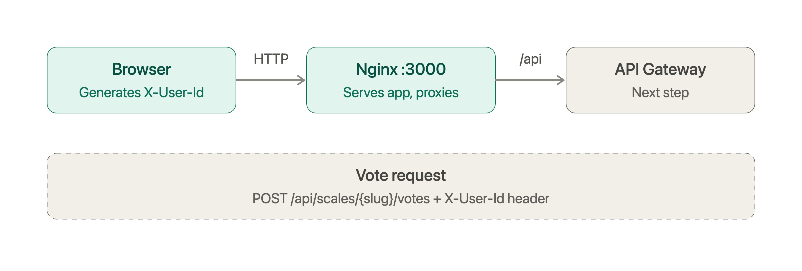

# Introduction

I want to make this post more about the technical aspect of Powerscale rather than the product itself (it's still in-development). The goal of this post is just me learning to build out a distributed microservices application.

# Architecture

(local at the moment)

# The Lifecycle of a vote

## User request -> Frontend

When a request is sent from the User, our frontend served by nginx does not use any account creation at the moment so we let the frontend generates a random ID for each browser (our way of identifying different users). The ID is then attached to every vote request `X-User-Id` as a request header. After which a POST request is then sent along with the request header as a payload to the API Gateway.

As I continue to scale Powerscale, in the future we would need to secure against stuffing from random curls and also impersonation of user ID to manipulate votes. But we also need to consider to make the process of powerscaling fun without needing users to always have an account to vote. One feature could be to give the option to enable secure voting for some scales or creating private scales.